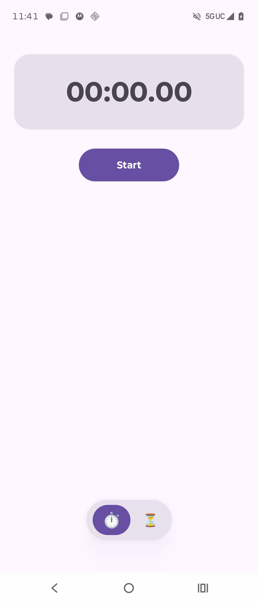
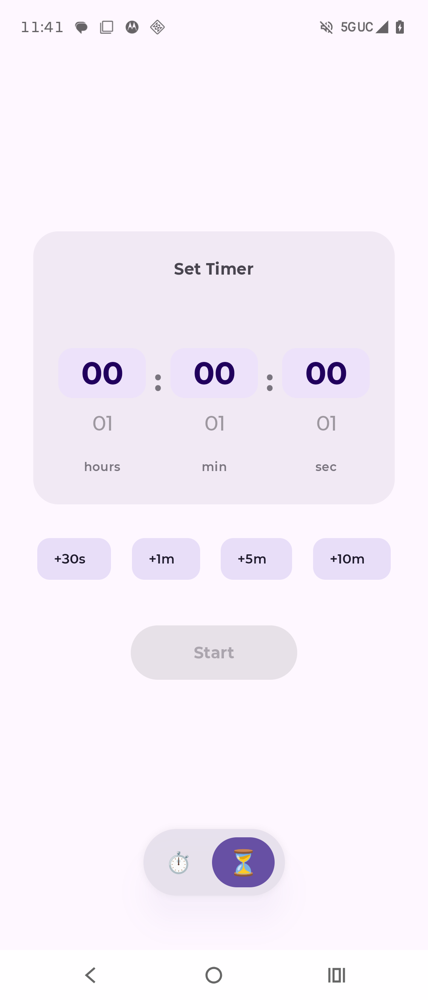
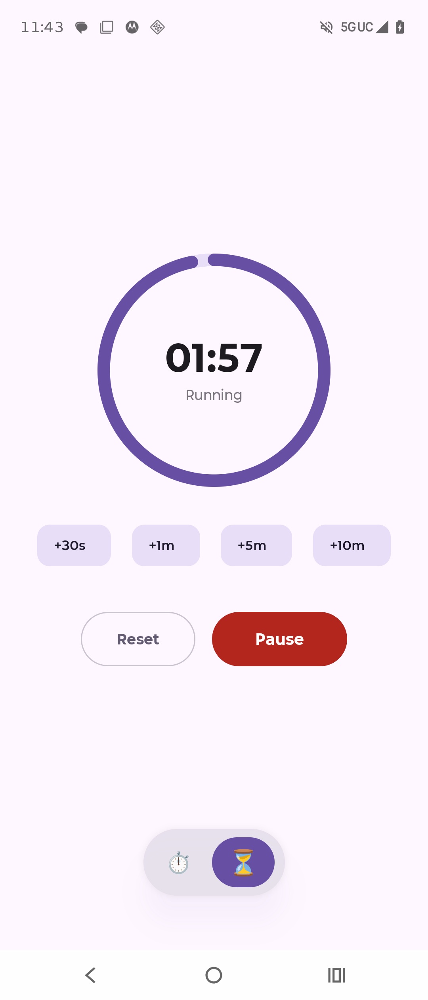
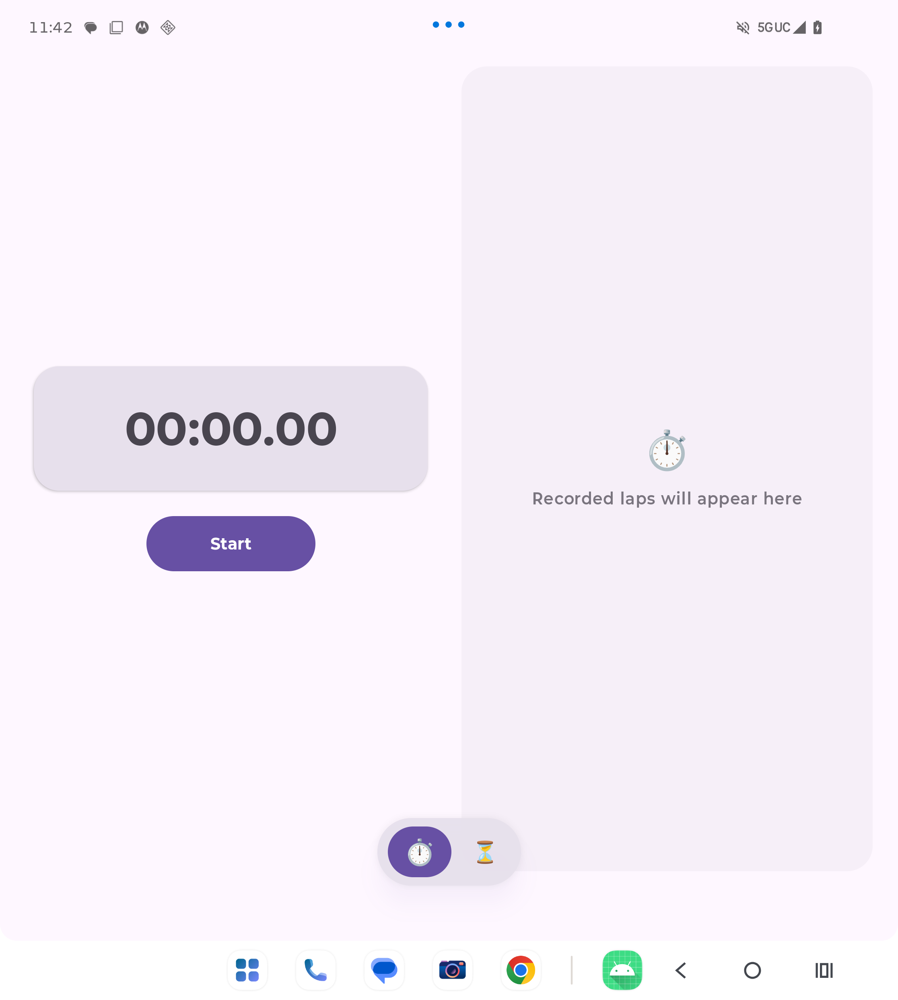
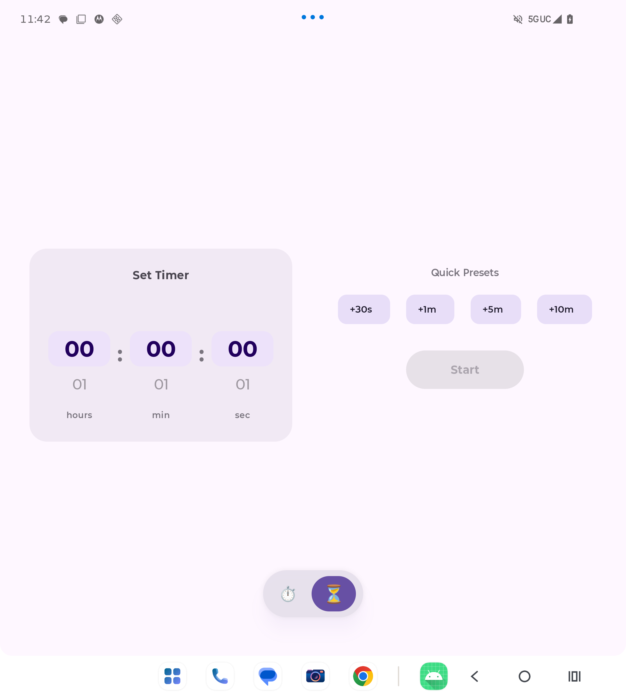
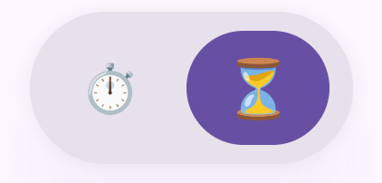

# ⏱️ Multiplatform Stopwatch & Timer (KMP + Compose Multiplatform)

A Kotlin Multiplatform (KMP) application providing a high-precision **Stopwatch** and **Countdown Timer** with an adaptive UI targeting **Android**, **iOS**, **Desktop (macOS, Windows, Linux)**, and **Web (Wasm & JS)**.

Built following **Clean Architecture** (Domain, Data, Presentation, Core) and the **MVI (Model-View-Intent)** architectural pattern.

---

## 📝 Logging System Architecture & Developer Guide

The application features a unified multiplatform logging facade designed to provide transparent, line-by-line visibility into execution flow, state transitions, domain calculations, and user interactions across all supported platforms.

---

### 🔍 1. How the `Log` Object Works

The centralized [`Log`](file:///Volumes/Gate_Keeper/TrainingStudioProjects/Portfolio%20%20Projects/Logger/shared/src/commonMain/kotlin/com/asura/logger/Log.kt) object wraps **Touchlab Kermit** (`co.touchlab.kermit.Logger`), providing a multiplatform logging API that outputs directly to each platform's native logging subsystem.

#### Tagging Standard
Every log statement specifies an explicit `tag` parameter adhering to the pattern:
$$\text{Tag} = \texttt{ClassName\_functionName()}$$

If no specific tag is provided, the logging utility automatically falls back to the constant `Log.APP_TAG` (`"ASURA_LOGGER"`).

#### Log Levels
* **`Log.d(message, tag)` (Debug):** Granular execution traces, incoming UI intents, user gesture/wheel scroll events, and calculation steps.
* **`Log.i(message, tag)` (Info):** High-level lifecycle transitions, state updates, use-case results, and side-effects.
* **`Log.w(message, tag)` (Warning):** Recoverable anomalies or unexpected states.
* **`Log.e(message, tag, throwable)` (Error):** Handled exceptions and critical operational failures.

---

### 🛠️ 2. Developer Guide: How to Use `Log`

To log code execution anywhere in the codebase, invoke `Log` methods with a descriptive message and the standard `ClassName_functionName()` tag:

```kotlin
class TimerViewModel(
  private val calculateProgressUseCase: CalculateTimerProgressUseCase
) : MviViewModel<TimerState, TimerIntent, TimerEffect>(TimerState()) {

  // 1. Log incoming intent execution
  override fun handleIntent(intent: TimerIntent) {
    Log.d("Handling intent: $intent", tag = "TimerViewModel_handleIntent()")
    when (intent) {
      is TimerIntent.Start -> startTimer()
      is TimerIntent.Reset -> resetTimer()
    }
  }

  // 2. Log state transitions and side-effects
  private fun startTimer() {
    Log.i("Starting timer with duration: ${currentState.duration}", tag = "TimerViewModel_startTimer()")
    setState { copy(isRunning = true) }
    sendEffect(TimerEffect.Started)
  }
}
```

---

### 📊 3. How to Collect & Filter Logs Across All Variants

You can filter logs either globally using the **`Log.APP_TAG`** constant (`"ASURA_LOGGER"`) or specifically using the **`ClassName_`** prefix across all platforms.

#### 🤖 1. Android
* **Android Studio Logcat:**
  Filter by tag:
  ```text
  tag:ASURA_LOGGER OR tag:TimerViewModel_ OR tag:StopwatchViewModel_
  ```
* **Terminal (`adb logcat`):**
  ```bash
  adb logcat -s "ASURA_LOGGER:*" "TimerViewModel_handleIntent():*" "StopwatchViewModel_handleIntent():*"
  ```

#### 🍏 2. iOS
* **Xcode Debug Console:**
  Run the app in Xcode (`⌘ + R`). Logs appear live in the bottom Debug Area console.
* **macOS `Console.app` (Visual GUI for connected iPhone):**
  1. Open `/System/Applications/Utilities/Console.app` and select your iPhone under **Devices**.
  2. Click **Action** in the top menu and check **"Include Info Messages"** and **"Include Debug Messages"**.
  3. Filter by `process:iosApp` and search for `ASURA_LOGGER` or any `ClassName_` tag in the search field.
* **macOS Terminal (`log stream` CLI):**
  ```bash
  log stream --device "<DEVICE_NAME_OR_UDID>" --process "iosApp" --level debug --predicate 'eventMessage CONTAINS "ASURA_LOGGER" OR eventMessage CONTAINS "ViewModel_"'
  ```

#### 💻 3. Desktop (macOS, Windows, Linux)
Run the desktop target from your terminal; logs print directly to standard output:
```bash
./gradlew :desktopApp:run
```
*(Filter live output: `./gradlew :desktopApp:run | grep -E "ASURA_LOGGER|ViewModel_|UseCase_"`)*

#### 🌐 4. Web (Wasm-JS & JavaScript)
1. Run the web application:
   ```bash
   ./gradlew :webApp:wasmJsBrowserDevelopmentRun
   ```
2. Open Browser Developer Tools (**F12** or **Cmd + Option + I**) -> **Console** tab.
3. Filter by typing `ASURA_LOGGER` or specific class names (e.g., `TimerViewModel`).

---

## 📱 Screenshots

### 📱 Mobile Portrait Modes

| ⏱️ Stopwatch Mode | ⏳ Timer Picker Mode | ⏳ Timer Countdown Mode |
| :---: | :---: | :---: |
|  |  |  |
| *Monotonic stopwatch & lap splits* | *Snap wheel picker & presets* | *Animated circular progress ring* |

---

### 📐 Adaptive & Dual-Pane Mode

| 📱 Phone Landscape (Dual-Pane) | 📱 Foldable / Tablet (Unfolded) |
| :---: | :---: |
|  |  |
| *Side-by-side: Clock & controls on left, Lap table on right* | *Optimized for wide unfolded foldable screens and tablets* |

---

### 🧭 Floating Navigation Bar

<p align="center">
  
  <br />
  <em>Logo-only floating navigation bar with spring-animated selection indicator</em>
</p>

---

## ✨ Features

### ⏱️ Stopwatch
- **Drift-Free Precision**: Powered by Kotlin's monotonic `TimeMark` provider for sub-second accuracy without system time drift.
- **Lap Splitting**: Records individual lap durations alongside total cumulative elapsed time.
- **Auto-Scrolling Lap List**: Automatically scrolls to reveal the latest recorded lap at the top of the table.
- **Uniform Styling**: Clean row dividers and structured columns (`Lap #`, `Lap Time`, `Total Time`).
- **Smooth Spring Controls**: Smooth, spring-animated button state transitions for `Start`, `Pause`, `Resume`, `Lap`, and `Reset`.

### ⏳ Countdown Timer
- **Interactive Snap Wheel Picker**: 3-column scrollable vertical wheel picker (`Hours`, `Minutes`, `Seconds`) with snapping physics and isolated programmatic synchronization.
- **Animated Countdown Gauge**: Smooth crossfade from configuration wheels to an animated circular progress ring with real-time remaining countdown display.
- **Quick Preset Chips**: Fast one-tap presets (`+30s`, `+1m`, `+5m`, `+10m`) for initial duration setup and runtime time extensions.
- **Completion Alert**: Animated banner notifying the user upon countdown completion with a dismiss action.

### 📐 Adaptive Layout & Rotation Support
- **Responsive Viewport Reflow**:
  - **Phone Portrait & Folded Outer Screens**: Single-column vertical layout with dedicated clearance for floating navigation.
  - **Unfolded Foldables, Tablets & Phone Landscape**: Dynamic **2-Column Dual-Pane** layout placing the Clock/Wheel on the left and Controls/Laps on the right.
- **Rotation & Lifecycle Continuity**:
  - `rememberSaveable` preserves active tab state across Activity recreation and configuration changes.
  - Tickers and monotonic coroutines continue counting seamlessly during rotation, folding, or unfolding.
- **Floating Logo-Only Navigation Bar**:
  - Sits centered (`BottomCenter`) in portrait and wide foldable screens for easy two-thumb reach.
  - Automatically shifts to `BottomEnd` on compact phone landscape mode to prevent vertical control clipping.

---

## 🏗️ Architecture & Project Structure

The project strictly follows **Clean Architecture** and **MVI**:

```
Logger/
├── androidApp/                     # Android application module
│   └── src/main/
│       ├── AndroidManifest.xml     # Configured for orientation & foldable screen layout
│       └── kotlin/com/asura/logger/MainActivity.kt
├── iosApp/                         # iOS application module (SwiftUI wrapper)
│   └── iosApp/
│       ├── iOSApp.swift            # SwiftUI App entry point
│       └── ContentView.swift       # Hosts ComposeUIViewController
├── desktopApp/                     # Desktop JVM application module (macOS, Windows, Linux)
│   └── src/jvmMain/kotlin/com/asura/logger/Main.kt
├── webApp/                         # Web application module (Wasm-JS & JS)
│   └── src/wasmJsMain/ & jsMain/
└── shared/                         # Core multiplatform shared module
    └── src/commonMain/kotlin/com/asura/logger/
        ├── core/                   # Shared architectural foundations
        │   ├── mvi/                # MviViewModel, UiState, UiIntent, UiEffect
        │   └── util/               # TimeFormatter (formatting mm:ss.SS, hh:mm:ss)
        ├── domain/                 # Pure domain business logic (no UI/framework dependencies)
        │   ├── model/              # Lap, StopwatchRecord, TimerDuration entities
        │   ├── repository/         # StopwatchRepository, TimerRepository interfaces
        │   └── usecase/            # CalculateLapSplits, NormalizeDuration, CalculateTimerProgress
        ├── data/                   # Data sources and repository implementations
        │   ├── datasource/         # MonotonicTimeSourceProvider
        │   └── repository/         # StopwatchRepositoryImpl, TimerRepositoryImpl
        └── presentation/           # UI layer (Compose Multiplatform & MVI)
            ├── navigation/         # FloatingNavBar, AppScreen
            ├── stopwatch/          # StopwatchScreen, StopwatchViewModel, StopwatchContract
            │   └── components/     # StopwatchClockCard, StopwatchControls, StopwatchLapList
            └── timer/              # TimerScreen, TimerViewModel, TimerContract
                └── components/     # TimerDurationPicker, WheelPicker, TimerProgressRing, TimerControls, TimerPresetChips
```

---

## 🚀 How to Run Each Variant

### Prerequisites
- **JDK 17 or higher** (e.g. Android Studio JBR or OpenJDK 17+)
- **Android Studio** (Ladybug / Meerkat or newer) with KMP plugins installed
- **Xcode** (15+ for iOS compilation on macOS)

---

### 🤖 1. Android App
Run on an Android emulator or connected physical device (supports foldables & tablets):

```bash
# Build and install debug APK to connected device/emulator
./gradlew :androidApp:installDebug

# Or build debug APK only
./gradlew :androidApp:assembleDebug
```

---

### 🍏 2. iOS App
Run on an iOS Simulator or connected iPhone:

1. Open `iosApp/iosApp.xcodeproj` in **Xcode**.
2. Select your target simulator (e.g., iPhone 15 Pro, iPad Pro) or connected device.
3. Press **Run (⌘ + R)**.

Alternatively, execute via Gradle to verify iOS metadata compilation:
```bash
./gradlew :shared:compileIosMainKotlinMetadata
```

---

### 💻 3. Desktop App (macOS, Windows, Linux)
Run the desktop Compose Multiplatform application natively:

```bash
# Standard Desktop Run
./gradlew :desktopApp:run
```

---

### 🌐 4. Web Application (Wasm & JS)
Run in modern browsers (Chrome, Edge, Firefox, Safari):

```bash
# Wasm-JS target (Recommended: high-performance WebAssembly)
./gradlew :webApp:wasmJsBrowserDevelopmentRun

# JavaScript target (Standard browser support)
./gradlew :webApp:jsBrowserDevelopmentRun
```

---

## 🧪 Composable Previews

All UI components and screens include interactive `@Preview` functions covering:
- **Portrait Idle & Running states**
- **Dual-Pane Landscape viewports** (`widthDp = 800, heightDp = 400`)
- **Foldable Unfolded Inner Screen viewports** (`widthDp = 700, heightDp = 750`)

You can preview any component directly in Android Studio / Fleet without deploying to a physical device.

---

## 🛠️ Verification & Compile Checks

To verify that all platform targets build cleanly from the command line:

```bash
./gradlew compileCommonMainKotlinMetadata compileKotlinJvm compileKotlinJs :androidApp:assembleDebug
```